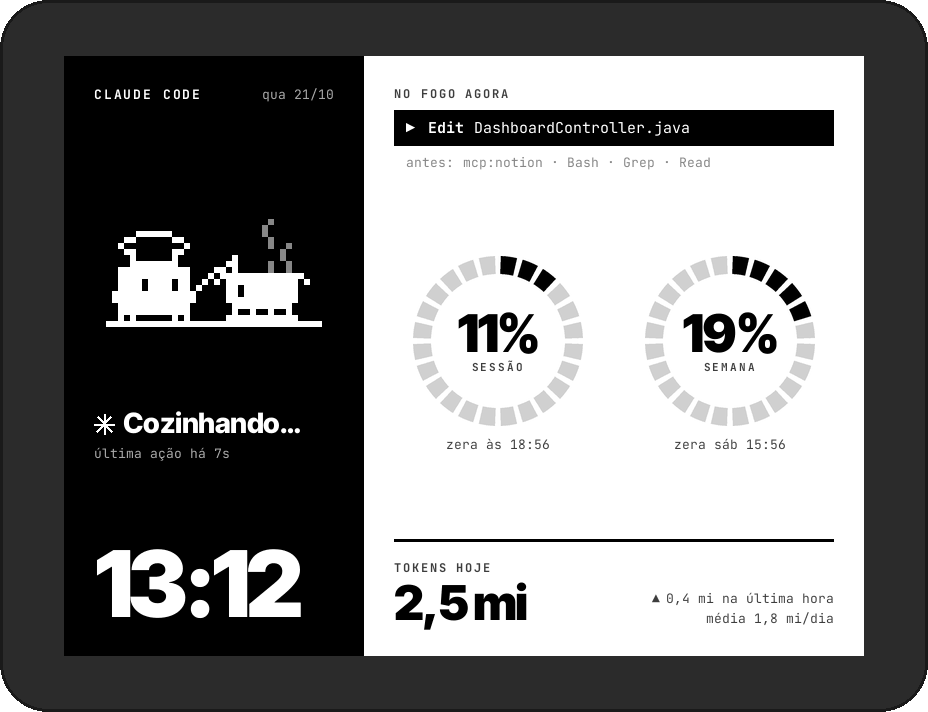
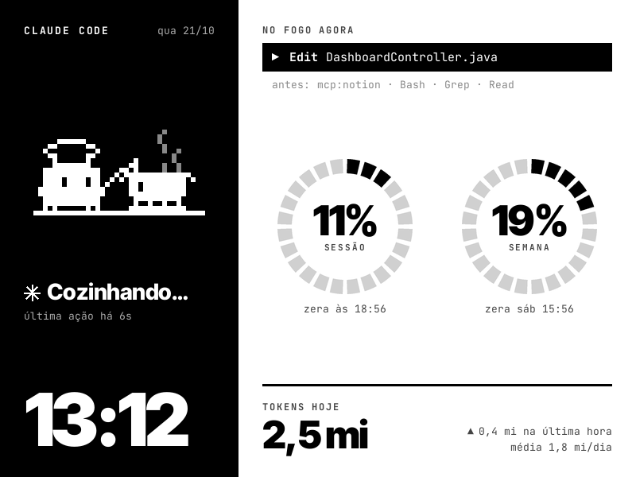
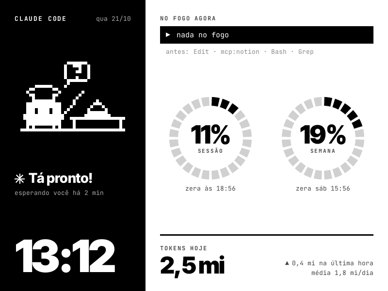
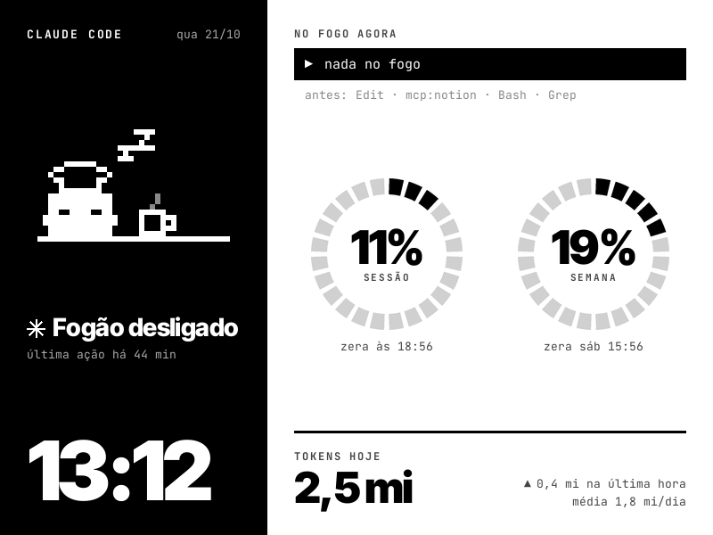
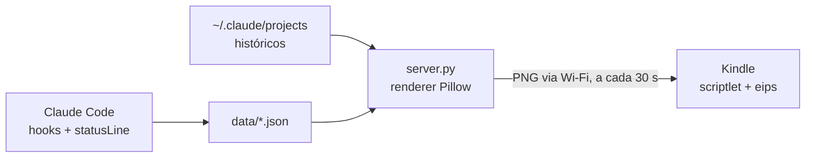

<h1 align="center">Claudinho no Kindle</h1>

<p align="center">
Um Kindle velho virou painel de mesa: ele mostra o que o Claude Code está cozinhando agora<br>
e quanto de token já foi pro fogo.
</p>

<p align="center">
  
</p>

<p align="center"><sub>Telas geradas pelo próprio servidor em modo demo, com a moldura desenhada por cima.</sub></p>

## O que é

Enquanto o Claude Code trabalha no computador, o Kindle do lado mostra:

- **O que ele está fazendo agora**: a ferramenta em uso (`Edit`, `Bash`, `Grep`…) e as últimas que passaram.
- **Quanto da janela de uso já foi**: % da sessão de 5h e % da semana, em anéis segmentados, com a hora em que cada um zera.
- **Tokens de hoje**, quanto entrou na última hora e a média diária.
- **O Claudinho chef**, um mascote em pixel art que muda de animação conforme o estado.

A tela é e-ink: atualiza devagar, não tem cor e não gasta bateria parada. Por isso o design inteiro usa preto, branco e quatro cinzas, e só o mascote se mexe.

## Os estados

| Cozinhando | Esperando você | Descansando |
|---|---|---|
|  |  |  |
| O Claude está trabalhando. A barra "No fogo agora" mostra a ferramenta atual. | Terminou e está esperando você (ou pedindo permissão, com o sino tocando mais rápido). | Parado há mais de 30 minutos. |

Com vários agentes rodando ao mesmo tempo, o painel mostra a sessão mais urgente: pedindo permissão > trabalhando > terminou > descansando.

## O Claudinho chef

Sete animações de 2 quadros cada, desenhadas numa grade de 36×24 pixels.

| | | | |
|:-:|:-:|:-:|:-:|
|  |  |  |  |
| Mexendo a sopa | Cortando cebola | Frigideira pro alto | Temperando |
|  |  |  | |
| Prato pronto | Tocando o sino | Cochilando com café | |

Enquanto o Claude trabalha, o servidor sorteia blocos de sopa, cebola, tempero e frigideira. A ideia original era uma animação por ferramenta, mas as ferramentas duram menos de um segundo e o Kindle só olha a cada 30. O processo de design está em [docs/design.md](docs/design.md).

## Como funciona



1. Os **hooks** do Claude Code gravam o estado de cada sessão em `data/state.json`.
2. A **statusLine** guarda o % de uso da sessão e da semana em `data/statusline.json`, e continua mostrando a statusLine que você já tinha.
3. O **servidor** lê isso, soma os tokens dos históricos em `~/.claude/projects`, desenha a tela 800×600 com Pillow e gira 90° pra tela em pé do Kindle.
4. O **Kindle puxa** pelo Wi-Fi a cada 30 s: lê `/status.txt` e baixa uma tela inteira por quadro da animação, só quando algo mudou. O computador nunca empurra nada.

Detalhes de cada peça em [docs/como-funciona.md](docs/como-funciona.md).

## Instalação

### O que você precisa

- **Kindle com jailbreak.** Testado num Kindle básico de 8ª geração (2016), firmware 5.15.1, tela 600×800. O jailbreak usado foi o [WinterBreak2](https://kindlemodding.org/jailbreaking/WinterBreak2) (firmwares abaixo de 5.16.4). Siga o guia do [Kindle Modding](https://kindlemodding.org) pro seu modelo. No Kindle não precisa instalar mais nada: o script usa `curl`, `eips` e `lipc-set-prop`, que já vêm no sistema.
- **Computador** com macOS ou Linux, Python 3.9+ e Pillow. Windows não funciona ainda (o `hook.py` usa `fcntl`).
- **Claude Code** rodando no mesmo computador do servidor.
- Kindle e computador **na mesma rede Wi-Fi**.

### No computador

```sh
git clone https://github.com/guithepc/kindle-claude.git
cd kindle-claude
pip3 install --user pillow
python3 setup.py          # liga os hooks e a statusLine no ~/.claude/settings.json (faz backup antes)
python3 server.py         # deixe rodando
```

Reinicie as sessões do Claude Code que já estavam abertas, pra elas passarem a mandar eventos.

Confira no navegador: <http://localhost:8787/preview.png?demo=esperando>

Anote o IP do computador na rede (no macOS: `ipconfig getifaddr en0`).

### No Kindle

1. Edite `kindle/claude_dash.sh` e troque o IP:
   ```sh
   MAC="<IP_DO_COMPUTADOR>"
   PORT=8787
   ```
2. Ligue o Kindle no cabo e copie `claude_dash.sh` pra pasta `documents`.
3. Ejete, conecte o Kindle no mesmo Wi-Fi e toque em **Claude Dash** na biblioteca. A tela aparece em alguns segundos.

### Configuração

| Onde | Opção | Padrão |
|---|---|---|
| `kindle/claude_dash.sh` | `MAC`: IP do computador | `IP_DO_MAC` |
| | `PORT` | `8787` |
| | `POLL`: segundos entre leituras | `30` |
| | `FULL_EVERY`: atualizações parciais antes de um refresh completo | `10` |
| variável de ambiente | `KINDLE_DASH_PORT` | `8787` |
| | `KINDLE_DASH_ROTATE`: `90` = logo "kindle" à esquerda, `270` = à direita | `90` |

## No dia a dia

| Ação | Como |
|---|---|
| Iniciar o servidor | `python3 server.py` (a janela precisa ficar aberta) |
| Iniciar o servidor sozinho (macOS) | `sh servico.sh` registra um LaunchAgent que sobe no login. `sh servico.sh remover` desfaz. *Não testado.* |
| Iniciar no Kindle | tocar em **Claude Dash** na biblioteca |
| Parar o painel | abrir <http://localhost:8787/parar>. O Kindle sai na próxima leitura (até 30 s) e volta pra tela inicial. Reiniciar o Kindle também resolve. |
| Remover os hooks | `python3 setup.py remover` |

Enquanto o painel roda, o script impede a proteção de tela e mantém o Wi-Fi ligado. Deixe o Kindle no carregador. Se o computador dormir, o Kindle mostra "sem conexão com o Mac…" até ele voltar.

## Estrutura

```
kindle-claude/
├── server.py            servidor HTTP + renderer (Pillow): monta a tela, gira e serve pro Kindle
├── hook.py              hook do Claude Code: grava o estado de cada sessão em data/state.json
├── statusline.py        statusLine: guarda o % de uso (5h e semana) e repassa a sua statusLine antiga
├── setup.py             instala/remove hooks e statusLine no ~/.claude/settings.json (com backup)
├── servico.sh           registra o servidor como LaunchAgent do macOS
├── sprites.json         os 14 quadros do Claudinho chef em grade 36×24
├── kindle/
│   └── claude_dash.sh   scriptlet que roda no Kindle (copiar pra documents/)
├── tools/
│   ├── build_sprites.py converte os quadros exportados do Paper em sprites.json
│   ├── sprites_src.json paths SVG dos quadros exportados do Paper
│   └── readme_media.py  gera as imagens deste README
├── design/
│   ├── paper/           telas e explorações exportadas do Paper
│   └── pixelart/chef.py o Claudinho escrito em ASCII
├── docs/                design, funcionamento e solução de problemas
├── fonts/               Inter Tight e JetBrains Mono (licença OFL)
└── data/                gerado em tempo de execução (fora do git)
```

## Limitações

- Só enxerga o Claude Code rodando no mesmo computador do servidor. Conversas no app do Claude e agentes em máquinas remotas não aparecem.
- O % de uso só existe em planos Pro/Max e aparece depois da primeira resposta da sessão.
- O total de tokens inclui leitura de cache, por isso fica alto.
- Layout feito pra tela 600×800 e testado só no macOS e num único Kindle.
- A animação em blocos sorteados foi validada em simulação. A validação visual no aparelho ainda está pendente.
- Pra sair do painel pelo próprio Kindle, só reiniciando.

Problemas encontrados no caminho e como resolver: [docs/problemas.md](docs/problemas.md).

## Créditos

Design feito no [Paper](https://paper.design). Sprites, anéis e telas gerados por código. Fontes [Inter Tight](https://fonts.google.com/specimen/Inter+Tight) e [JetBrains Mono](https://www.jetbrains.com/lp/mono/), licença OFL.

> Projeto pessoal, sem afiliação com a Anthropic. O Claudinho é fan art inspirada no mascote do Claude Code.

## Licença

[MIT](LICENSE). As fontes em `fonts/` seguem as próprias licenças OFL.
