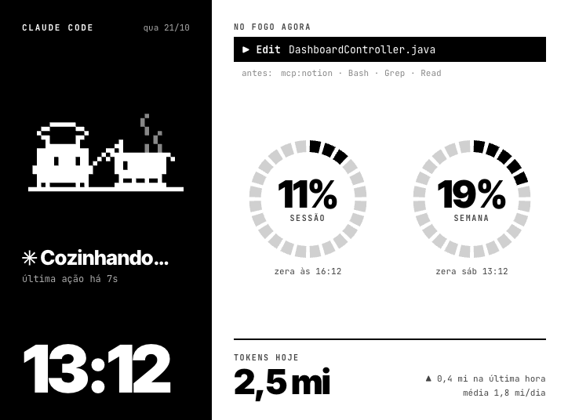
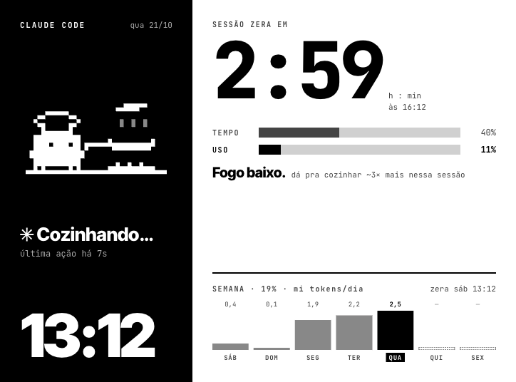
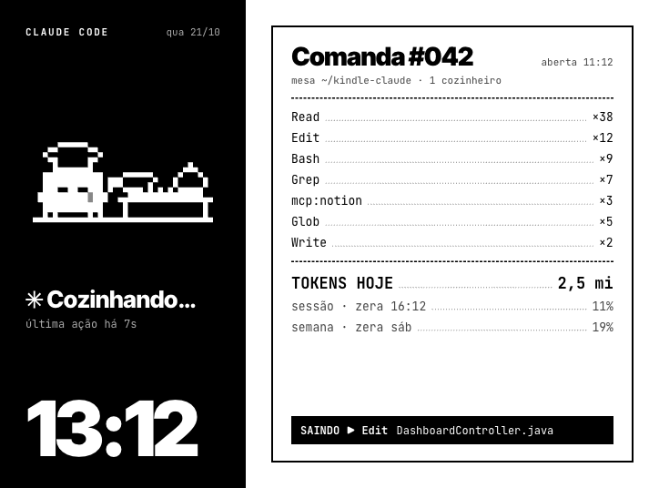
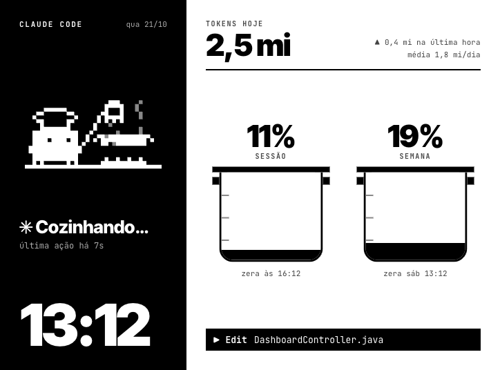
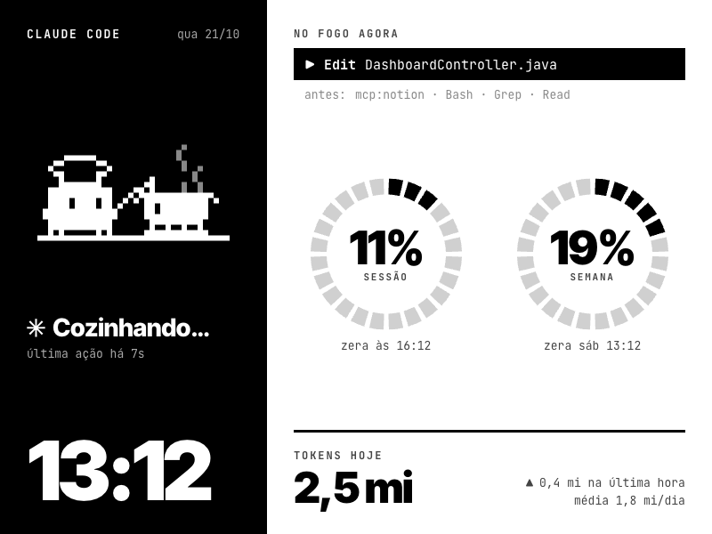
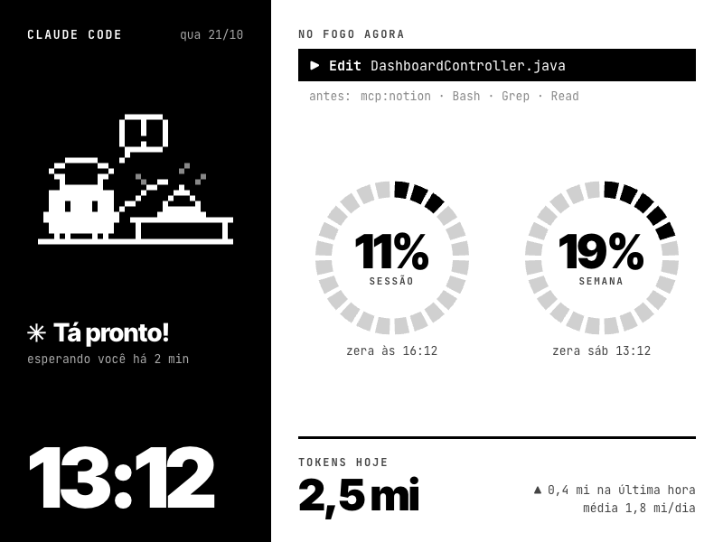
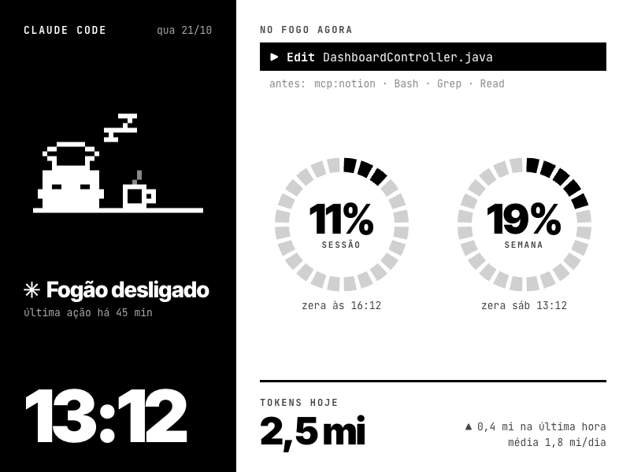
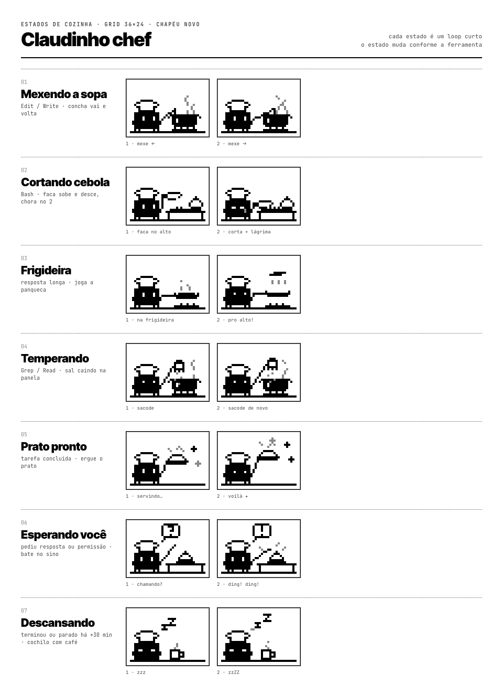

# Design

O painel foi desenhado no [Paper](https://paper.design) antes de existir uma linha de código. O servidor depois copiou posições, fontes e espaçamentos das camadas e foi conferido sobrepondo o render ao print do Paper, com diferença de cerca de 1 px.

## Explorações

A primeira rodada teve versões em pé e deitadas. A deitada com o painel preto do mascote à esquerda ganhou, e virou quatro variações com temas de cozinha:

| H2.A · Bocas do fogão (escolhida) | H2.B · Timer de cozinha |
|---|---|
|  |  |
| **H2.C · Comanda** | **H2.D · Panelas** |
|  |  |

A H2.A, com os dois anéis como bocas de fogão, foi refeita em 800×600, a resolução do Kindle básico, em três telas:

| Trabalhando | Esperando | Descansando |
|---|---|---|
|  |  |  |

## Regras de e-ink

| O quê | Como | Por quê |
|---|---|---|
| Cores | `#000` `#444` `#888` `#AAA` `#D0D0D0` `#FFF`, sem gradiente | e-ink tem poucos níveis de cinza e gradiente vira serrilhado |
| Mascote | numa área fixa de 216×144 no painel preto | só essa área muda entre os quadros, então o resto da tela fica parado |
| Fantasma | refresh completo quando o estado muda e a cada 10 trocas | limpa o resíduo das imagens anteriores |
| Texto | atualiza a cada 30 s | número mudando o tempo todo borra e gasta bateria |
| Sprites | escala inteira (células de 6 px), sem antialias | pixel art nítida |
| Anéis | 24 segmentos com fresta, preenchidos em preto, vazios em `#D0D0D0` | lê de longe sem precisar de número |

## O Claudinho chef



Cada animação tem só 2 quadros. Mais que isso, o e-ink não acompanha.

| Animação | Quando aparece |
|---|---|
| Mexendo a sopa | trabalhando (sorteada) |
| Cortando cebola, com lágrima no quadro 2 | trabalhando (sorteada) |
| Frigideira pro alto | trabalhando (sorteada) |
| Temperando | trabalhando (sorteada) |
| Prato pronto | logo depois de terminar |
| Tocando o sino, com balão de "?" e "!" | esperando você ou pedindo permissão |
| Cochilando com café e Zzz | parado há mais de 30 min |

Alguns ajustes que vieram na revisão:

- O chapéu de chef parecia um coração, depois as pregas pareciam dentes. Ficou um chapéu liso de 6 linhas.
- A primeira versão tinha o Claudinho dentro da panela. Ele saiu e a panela foi pro lado.
- A faca parecia um "F" e o saleiro parecia uma bandeira. Os dois foram redesenhados.
- A frigideira tinha um terceiro quadro, virando a comida, que saiu.

## Pixel art escrita em texto

Nenhum sprite foi desenhado num editor de imagem. Cada quadro é uma grade ASCII de 36×24 em [`design/pixelart/chef.py`](../design/pixelart/chef.py): `#` é traço, `g` é cinza, `w` é branco forçado e `.` é vazio.

```
.....######...............g.........
...##wwwwww##..............g........
..#wwwwwwwwww#.............g..g.....
...##wwwwww##................g......
....#wwwwww#.........#.......g......
....########........##.....g..g.....
..############....##.#.....g..g.....
..############...#.##############...
..####.####.##..#.#.############.#..
..####.####.##.#....##w#########....
.##############.....##w#########....
.##############.....############....
..############.......##########.....
..############.......#..#..#..#.....
..#.#......#.#......############....
####################################
```

O caminho até o Kindle:

1. `chef.py` monta as cenas com funções pequenas (`clawd`, `soup_pot`, `steam`, `counter`…) e gera um SVG por quadro, com um path por cor pra não sobrar fresta entre os pixels.
2. Os SVGs foram pro Paper, onde entraram no layout.
3. Os quadros foram exportados do Paper como paths (`tools/sprites_src.json`), e `tools/build_sprites.py` converteu de volta em grades no `sprites.json`.
4. O servidor desenha cada célula como um quadrado de 6×6 px, branco sobre preto.

Pra ver as grades no terminal:

```sh
python3 design/pixelart/chef.py sopa cebola
```
